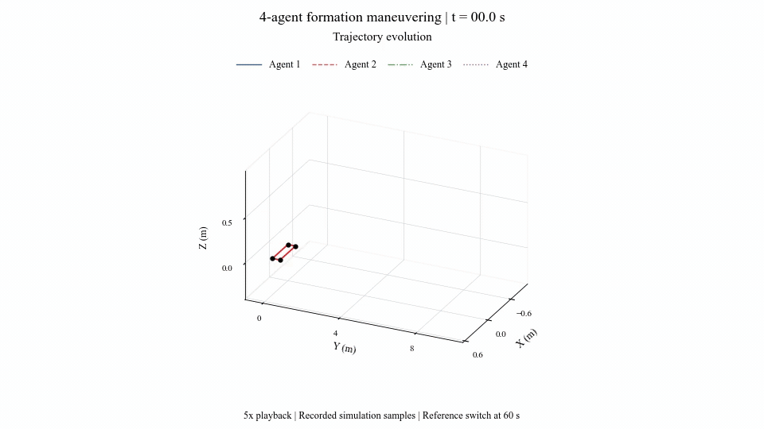
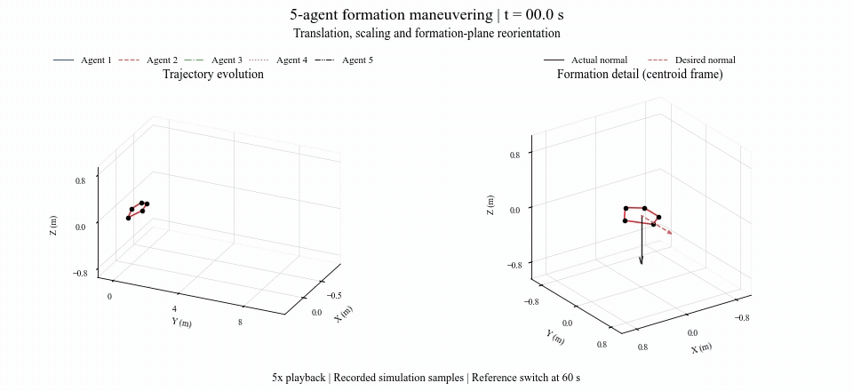
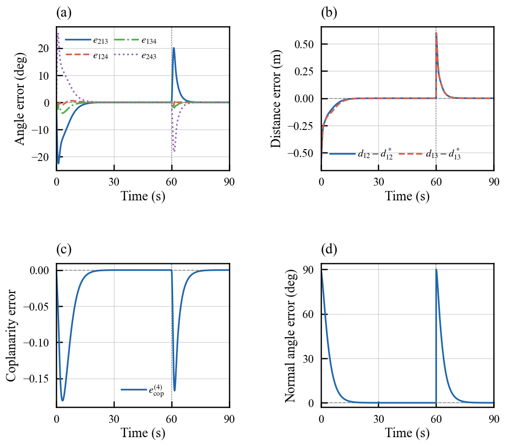
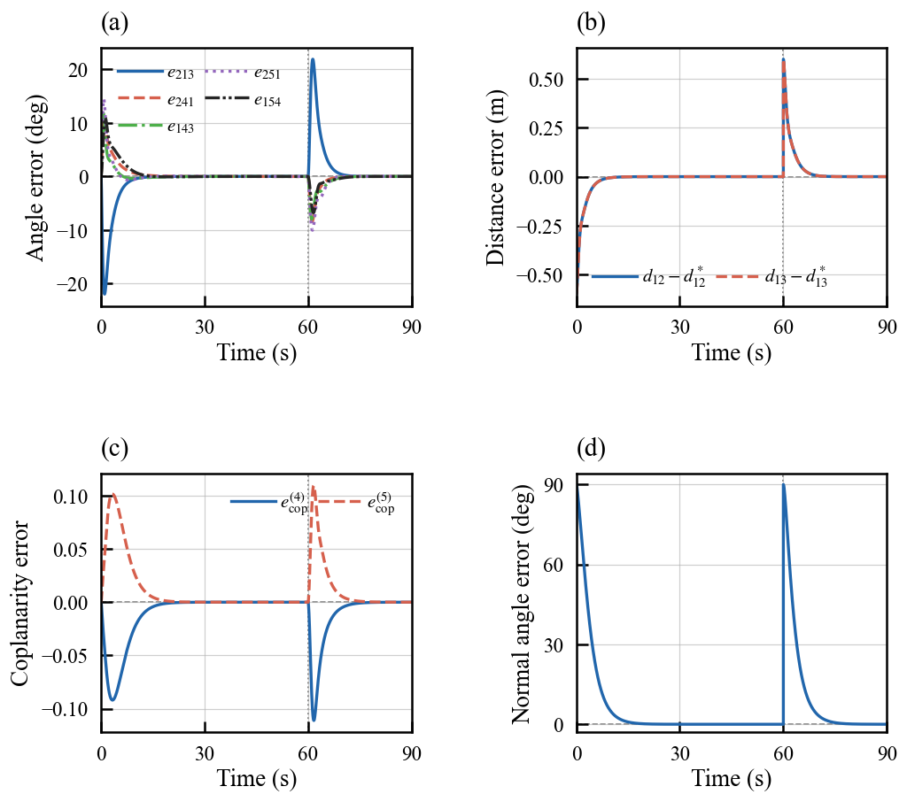
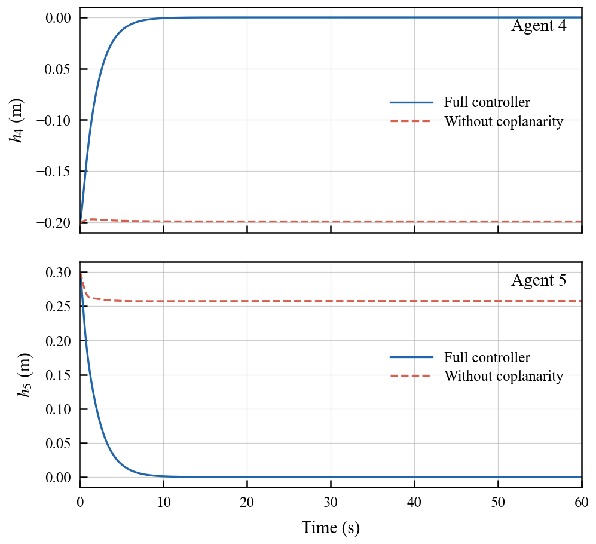
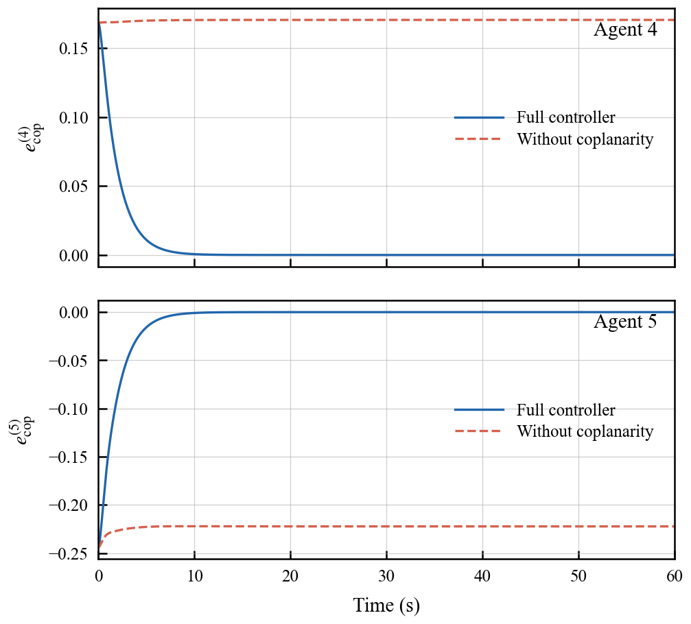
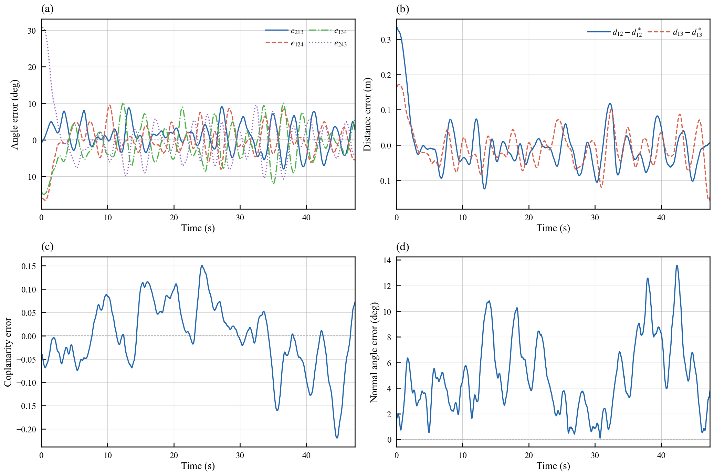
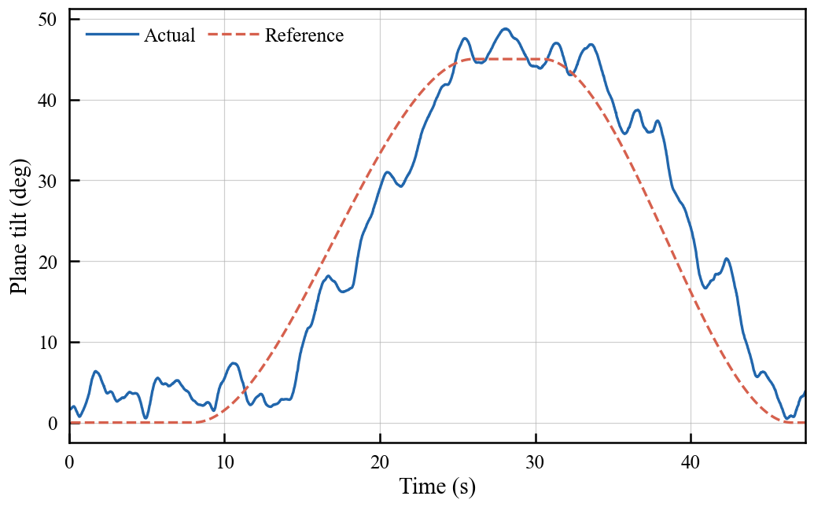

# Planar Formation Control in 3D

Visual results for distributed planar formation control with shape, scale, coplanarity, and formation-plane orientation regulation.

**[Simulation Results](#simulation-results)** · **[Experimental Results](#experimental-results)**

## Simulation Results

### Formation Maneuvering

Four-agent and five-agent formations perform simultaneous translation, scaling, and plane reorientation under double-integrator dynamics. The scale and normal references change directly at 60 s. The animations show the trajectory evolution in a single view.

The GIFs cover the complete 90-s simulation at **5× playback speed**.

#### Four-Agent Square

[Download MP4](assets/simulation/4agent_maneuver.mp4)

#### Five-Agent Pentagon

[Download MP4](assets/simulation/5agent_maneuver.mp4)

#### Formation Error Curves

<table>
  <tr><th>Four-agent square</th><th>Five-agent pentagon</th></tr>
  <tr>
    <td></td>
    <td></td>
  </tr>
</table>

Each figure shows angle, controlled-distance, coplanarity, and normal-angle errors. Both angular quantities are expressed in degrees.

### Coplanarity Constraint Necessity

A five-agent comparison evaluates the full controller and the controller with the coplanarity term disabled. The full controller corrects the out-of-plane deviations, whereas residual deviations remain without the coplanarity term.

<table>
  <tr><th>Out-of-plane displacement</th><th>Coplanarity error</th></tr>
  <tr>
    <td></td>
    <td></td>
  </tr>
</table>

## Experimental Results

The flight platform uses PX4-based quadrotors and NOKOV motion-capture position feedback. The demonstrations show formation maintenance during translation and formation-plane reorientation.

### Flight Demonstrations

The videos can be played directly below. Both recordings retain the physical footage, the corresponding RViz visualization, and the original selected audio. RViz displays the complete trajectory history and ground-to-agent height lines.

#### Three-UAV Formation

https://github.com/user-attachments/assets/b8f2b7d4-9d75-495b-b5f2-3bf143289cb9

46.1 s · Original playback speed

#### Four-UAV Formation

https://github.com/user-attachments/assets/f0fc16f8-ea4c-4aae-8bc2-ac160ef96c68

61.1 s · Original playback speed

### Four-UAV Tracking Results

The following curves come from a **separate four-UAV flight** with 1-m square-side references. The task consists of horizontal formation shaping, translation with a 45° plane tilt, deceleration, and a return to a horizontal formation.

The panels show cyclic-angle errors, the two controlled-distance errors, the dimensionless signed coplanarity error, and the normal-angle error.

  

The flight videos are presented with the original approximate action alignment between physical footage and visualization.
